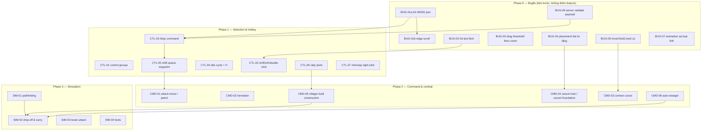

# RTS Controls Overhaul — Plan Index

Mục tiêu: đưa thao tác (input + command) của game về đúng chuẩn **Age of Empires II**,
theo từng bước nhỏ, mỗi bước là một thay đổi độc lập có thể review và rollback.

- Baseline hiện trạng: [`00-baseline.md`](./00-baseline.md)
- Phase 0 — Sửa bug: [`01-bugfixes.md`](./01-bugfixes.md)
- Phase 1 — Selection & hotkey: [`02-selection-and-controls.md`](./02-selection-and-controls.md)
- Phase 2 — Command & combat: [`03-commands-and-combat.md`](./03-commands-and-combat.md)
- Phase 3 — Simulation depth: [`04-simulation.md`](./04-simulation.md)
- Backlog / chưa làm: [`99-backlog.md`](./99-backlog.md)

## Nguyên tắc chia việc

1. **Mỗi task = 1 commit** (hoặc 1 PR). Không gộp 2 task khác phase vào một commit.
2. Task nào chạm vào protocol (`NetworkMessage`) phải cập nhật **cả 3 chỗ**:
   `packages/shared/src/types/index.ts` → `apps/server/src/rooms/WorldRoom.ts` → `apps/client/src/game/scenes/WorldScene.ts`.
3. Thay đổi `@type()` trong schema (`apps/server/src/schema/*`) là **breaking** với
   snapshot đã lưu trong `apps/server/database/dev.db` → phải ghi rõ bước reset DB trong task.
4. Trước khi đánh dấu xong: `tsc --noEmit` cho cả `apps/server` và `apps/client`.
5. Không commit/push khi chưa được phép. Commit message bằng tiếng Anh.

## Quyết định đã chốt

| # | Câu hỏi | Quyết định |
| --- | --- | --- |
| 1 | Xung đột `W` (pan vs build) | **Bỏ WASD pan**, giữ `Q/W/E/R/T` build, pan bằng mũi tên + edge scroll (`BUG-01a`, `BUG-01b`) |
| 2 | Có cần lệnh Stop? | **Có** — nhưng hạ ưu tiên xuống cuối Phase 1, và làm rõ Stop = huỷ lệnh + đứng yên (`CTL-03`) |
| 3 | Dân xây nhà + mang tài nguyên về? | **Có** — đưa kinh tế về chuẩn AoE (`CMD-05`, `SIM-02`) |

## Thứ tự phụ thuộc

## Trạng thái

| Task | Phase | Size | Status |
| --- | --- | --- | --- |
| BUG-01a | 0 | S | DONE |
| BUG-01b | 0 | S | DONE |
| BUG-02 | 0 | S | DONE |
| BUG-03 | 0 | S | DONE |
| BUG-04 | 0 | S | DONE |
| BUG-05 | 0 | S | DONE |
| BUG-06 | 0 | M | DONE |
| BUG-07 | 0 | S | DONE |
| BUG-08 | 0 | S | DONE |
| CTL-01 | 1 | M | DONE |
| CTL-02 | 1 | M | DONE |
| CTL-03 | 1 | M | DONE |
| CTL-04 | 1 | S | DONE |
| CTL-05 | 1 | L | DONE |
| CTL-06 | 1 | M | DONE |
| CTL-07 | 1 | S | DONE |
| CMD-01 | 2 | L | DONE |
| CMD-02 | 2 | M | DONE |
| CMD-03 | 2 | M | DONE |
| CMD-04 | 2 | M | DONE |
| CMD-05 | 2 | L | DONE |
| CMD-06 | 2 | S | DONE |
| SIM-01 | 3 | L | DONE |
| SIM-02 | 3 | L | DONE |
| SIM-03 | 3 | M | DONE |
| SIM-04 | 3 | M | DONE |

Size: **S** < 2h, **M** ~ nửa ngày, **L** >= 1 ngày.

## Definition of Done (chung)

- [ ] `cd apps/server && ../../node_modules/.bin/tsc --noEmit` sạch
- [ ] `cd apps/client && ../../node_modules/.bin/tsc --noEmit` sạch
- [ ] Thao tác chạy được trong game thật (không chỉ typecheck)
- [ ] Không tạo message mới nếu có thể tái dùng `MOVE_UNITS` / `ATTACK_TARGET`
- [ ] Task có sửa schema → đã ghi chú reset DB
